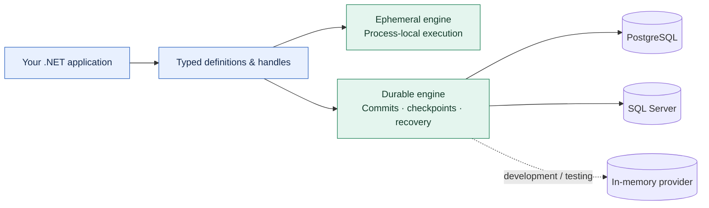

<div align="center">

# 🐋 OrcaCore

**Typed workflows. Explicit durability. Your .NET host.**

[](global.json) [](https://github.com/dekrevedko/Workflow-orca/releases/tag/v0.1.0-preview.2) [](docs/github-publishing-status.md) [](LICENSE)

[Quick start](#use-in-another-project) · [Why OrcaCore](#why-orcacore) · [Comparison](#how-it-compares) · [Status](#current-status) · [Documentation](#documentation)

</div>

Build workflow logic in C#, keep execution inside your application, and choose the lifetime
your workload needs: **ephemeral** for process-local coordination, or **durable** with
PostgreSQL or SQL Server for persisted execution and recovery.

> **Available on NuGet.org:** [v0.1.0-preview.2](https://www.nuget.org/packages/OrcaCore.Engine.Ephemeral/0.1.0-preview.2)
> ships twelve installable packages. This is a pre-production preview; see [current status](#current-status)
> and [remaining work](#remaining-work) before adoption.

## Why OrcaCore

OrcaCore is built for teams who want workflow execution to be a deliberate part of their
.NET application architecture. Its strongest advantages are:

- **Two execution modes, shared application concepts.** Author typed definitions and work with
  definition/instance handles in both modes. Choose persistence explicitly; durable mode uses
  registered named steps, while ephemeral mode also supports lambdas.
- **State ownership you can reason about.** Each attempt receives detached state; winning
  attempts commit replacements. Parallel branches have isolated state and explicit joins and
  merges. This makes data flow visible in the workflow definition.
- **Results that preserve the decision.** Registration and start return inspectable typed
  outcomes. Start idempotency binds to the definition and input fingerprints, and terminal
  outputs are typed. Waiting for output supports cancellation of the caller's wait.
- **An engine that fits your host.** Register the engine role through dependency injection and
  choose its provider packages. Your application owns endpoints, authentication, and deployment;
  the engine runs in your .NET process.
- **Resource ownership beyond a timeout.** Durable resource scopes retain or quarantine capacity
  when external work remains ambiguous, so a timeout alone cannot make that capacity reusable.
- **The shipped packages are part of the validation.** Release CI restores the complete package
  set into a fresh external consumer and runs a typed workflow, in addition to engine and real
  PostgreSQL/SQL Server tests.

Read the [ephemeral guide](docs/ephemeral-engine-developer-guide.md) and
[delivery guarantees](docs/production-readiness.md#delivery-guarantees) for the precise boundaries.



Choose one engine role per service container. The two modes share authoring concepts;
their persistence and supported step shapes remain explicit.

## A workflow in C#

This definition comes from the [runnable typed example](samples/OrcaCore.Examples/ExampleRunner.cs),
which includes host registration, idempotent start, and awaiting the typed output:

```csharp
var definition = Workflow.Ephemeral<CounterState>(
        DefinitionId.New(), DefinitionVersion.Initial)
    .Init<CounterInput>(input => new CounterState(input.Value))
    .Then(context =>
    {
        context.ReplaceState(context.State with { Value = context.State.Value + 1 });
        return ValueTask.CompletedTask;
    })
    .End(
        snapshot => new CounterOutput(snapshot.Value.Value),
        WorkflowOutcomeName.Create("completed"))
    .Build();
```

The sample starts with `41` and produces the typed result `42`.

## How it compares

OrcaCore's edge is the combination of embedded execution, explicit engine roles, and tightly
specified application contracts. The table describes where that combination is a good fit;
the alternatives also provide substantial capabilities of their own.

| Alternative | Its documented approach | Where OrcaCore fits better |
|---|---|---|
| [Workflow Core](https://github.com/danielgerlag/workflow-core#readme) | An embeddable .NET engine with fluent and JSON/YAML definitions, pluggable persistence, and concurrency providers. | You specifically want OrcaCore's typed start/output contracts, fingerprint-bound idempotency, detached attempt state, and explicit branch merges. |
| [Temporal](https://docs.temporal.io/temporal) | A durable execution platform comprising a Temporal Service and application workers. | You want the workflow engine embedded in your existing .NET host, with a process-local mode and a durable mode backed by your chosen SQL provider. |
| [Elsa Workflows](https://docs.elsaworkflows.io/) | .NET workflow libraries with C#, JSON, and visual authoring through Elsa Studio. | Your team keeps definitions in C# and prioritizes a focused typed API, explicit state ownership, and engine-role boundaries. |

Comparison reviewed **2026-10-16**, using the linked upstream documentation. These are
architecture and API tradeoffs. Comparative throughput, latency, and memory benchmarks have
not been published. OrcaCore is still a prerelease; features such as Saga, a visual workflow
designer, and broader lifecycle management are outside its current shipped surface.

## Current status

As of **2026-10-22**, [**v0.1.0-preview.2 is published**](https://github.com/dekrevedko/Workflow-orca/releases/tag/v0.1.0-preview.2)
and available for use in other .NET 10 projects. This is a **pre-production prerelease**;
APIs, provider schemas, and persistence formats can change.

| Item | Status |
|---|---|
| Distribution | Twelve packages on NuGet.org; package files and `SHA256SUMS` also available on the GitHub release |
| NuGet.org | [All twelve versions and source metadata verified; a fresh NuGet.org-only consumer returned `42`](https://github.com/dekrevedko/Workflow-orca/actions/runs/39905678249) |
| Published source | [`af0b29f`](https://github.com/dekrevedko/Workflow-orca/commit/af0b29f573571fa2705aed70cf1d9e0236c58a94) |
| Release validation | [Build, tests, coverage, provider/integration tests, packaging and clean consumer passed](https://github.com/dekrevedko/Workflow-orca/actions/runs/39905678249) |
| Engine line coverage | Passed the approved **75%** gate |
| Downloaded packages | Exact twelve-package inventory, SHA-256 checksums and source metadata verified |
| Included changes | [#7: Retention](https://github.com/dekrevedko/Workflow-orca/pull/7), [#8: Shutdown](https://github.com/dekrevedko/Workflow-orca/pull/8), [#9: Native assessment](https://github.com/dekrevedko/Workflow-orca/pull/9) |

See the [publishing record](docs/github-publishing-status.md) for validation details.

## Use in another project

Install directly from NuGet.org in a .NET 10 project:

```powershell
dotnet add ./YourProject.csproj package OrcaCore.Engine.Ephemeral --version 0.1.0-preview.2
```

Replace `./YourProject.csproj` with your project path. For durable applications, reference
`OrcaCore.Durable.Hosting` and the PostgreSQL or SQL Server provider at the same version.
`OrcaCore.Providers.InMemory` is for development and testing. The
[package installation guide](docs/packages.md) covers the package roles and the alternative
GitHub release download feed.

## Remaining work

- Durable DAG execution is incomplete; package availability does not complete its implementation gates.
- Released preview.2 retains issue #3's unsupported trimming/AOT profiles. Issue #13
  qualifies a new source candidate's bounded ephemeral recipe; its release is pending.
  See [native support and startup requirements](docs/ephemeral-native-support.md).
- Retention is opt-in and is not a byte/RSS cap or a minimum result-retention guarantee.
  Shutdown requires the actual dependency owner to retain resources after `Incomplete`.

Issues [#1](https://github.com/dekrevedko/Workflow-orca/issues/1),
[#2](https://github.com/dekrevedko/Workflow-orca/issues/2) and
[#3](https://github.com/dekrevedko/Workflow-orca/issues/3) are closed. Preview 2 includes
the reviewed retention and cooperative shutdown APIs; see the
[release notes](docs/prerelease-notes.md) for behavior changes and limitations.

One competing-owner handoff check failed intermittently during a documentation follow-up;
the CI retry, 30 isolated repetitions, and the full infrastructure suite passed. Its cause
remains unconfirmed; the evidence is recorded in [PR #4](https://github.com/dekrevedko/Workflow-orca/pull/4).
See [production readiness](docs/production-readiness.md) before choosing a deployment scope.

The shutdown API drains initialized pending starts and accepted handles through
an ordered Generic Host drainer, an explicitly owned host, or a plain-DI submission
gate. `ApplicationStopping` only closes admission; the engine's hosted stop or direct
`StopAsync` cancels and joins remaining work. Retain dependencies on `Incomplete`;
the [engine guide](docs/ephemeral-engine-developer-guide.md#shutdown-drain-recipes)
explains each ownership recipe and the `RunAsync` disposal caveat.

## Build and run from source

Use the SDK pinned by `global.json` and run from the repository root:

```powershell
dotnet build OrcaCore.slnx -c Release -warnaserror
dotnet test tests/OrcaCore.Engine.Ephemeral.Tests/OrcaCore.Engine.Ephemeral.Tests.csproj
dotnet run --project samples/OrcaCore.Examples/OrcaCore.Examples.csproj
```

## Documentation

- [Ephemeral Engine Developer Guide](docs/ephemeral-engine-developer-guide.md)
- [Documentation Index](docs/README.md)
- [Active Implementation Index](docs/active-implementation-index.md)
- [Samples](samples/README.md)
- [Production Readiness Notes](docs/production-readiness.md)
- [Install packages and publish a prerelease](docs/packages.md)
- [Durable Driver Requirements](docs/specs/16-requirements-durable-driver.md)
- [Integration Gates](tests/OrcaCore.Integration.Tests/README.md)

The superseded prototype and its original solution metadata are preserved under
[`archive/legacy-poc/`](archive/legacy-poc/); the root `src/`, `tests/`, samples,
benchmarks, and solution are the active implementation.

## Native publishing assessment (approved 2026-10-21)

Issue #3's assessment is independently approved at 7639189 / verdict baae5ad.
The public-package consumer passes all sixteen JIT scenarios on Windows Server 2025
and Ubuntu 24.04. Trimmed and Native AOT defaults and JSON-reflection-enabled extras
are unsupported for the earlier preview.2 profile. That assessment grants no
native support to those released packages. See [the assessment harness](tools/ephemeral-native-assessment/README.md)
for the tested packages, toolchain, raw evidence and reproduction instructions.

## Native AOT and trimming (issue #13; source-qualified, release pending)

User-approved corrected source `d8c55f3`, with review-only child `25fa36c`, passes the selected
public ephemeral recipe on Windows Server 2025 x64 and Ubuntu 24.04 x64 in JIT,
full-trim and Native AOT profiles. [Native run 40762764617](https://github.com/dekrevedko/Workflow-orca/actions/runs/40762764617)
records all six cells, 384 cases total. Preview.2 remains the existing released version and lacks
`WorkflowJsonMetadata`; no new version or broad compatibility badge is published.

The [qualified recipe](docs/ephemeral-native-support.md) explains packages,
source-generated metadata, process-wide startup order, the finite type boundary
and diagnostics. Keep product converter attributes; do not add the public factory
to context options. Live event delivery/resumption and outgoing publishing remain
outside native credit. Durable/DAG/providers and other RIDs need separate proof.
