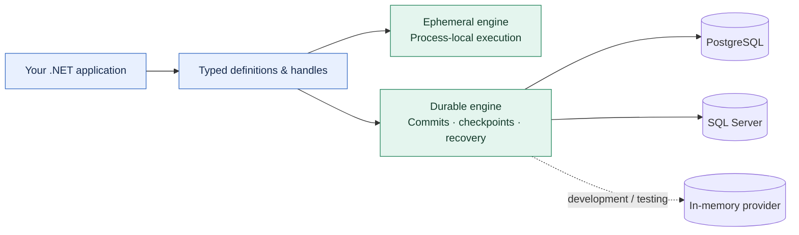

<div align="center">

# 🐋 OrcaCore

**Typed workflows. Explicit durability. Your .NET host.**

[](global.json) [](https://github.com/dekrevedko/Workflow-orca/releases/tag/v0.1.0-preview.1) [](docs/github-publishing-status.md) [](LICENSE)

[Quick start](#use-in-another-project) · [Why OrcaCore](#why-orcacore) · [Workflow Core comparison](#orcacore-vs-workflow-core) · [Status](#current-status) · [Documentation](#documentation)

</div>

Build workflow logic in C#, keep execution inside your application, and choose the lifetime
your workload needs: **ephemeral** for process-local coordination, or **durable** with
PostgreSQL or SQL Server for persisted execution and recovery.

> **Available now:** [v0.1.0-preview.1](https://github.com/dekrevedko/Workflow-orca/releases/tag/v0.1.0-preview.1)
> ships twelve installable packages. This is a pre-production preview; see [current status](#current-status)
> and [remaining work](#remaining-work) before adoption.

## Why OrcaCore

For teams evaluating [Workflow Core](https://github.com/danielgerlag/workflow-core), OrcaCore
focuses on explicit contracts for execution lifetimes, state ownership, starts, and outputs.
Its strongest advantages for an embedded .NET application are:

- **Two execution modes, shared application concepts.** Author typed definitions and work with
  definition/instance handles in both modes. Choose persistence explicitly; durable mode uses
  registered named steps, while ephemeral mode also supports lambdas.
- **State ownership you can reason about.** Each attempt receives detached state; winning
  attempts commit replacements. Parallel branches have isolated state and explicit joins and
  merges. This makes data flow visible in the workflow definition.
- **Results that preserve the decision.** Registration and start return inspectable typed
  outcomes. Start idempotency binds to the definition and input fingerprints, and terminal
  outputs are typed. Waiting for output supports cancellation of the caller's wait.
- **An engine that fits your host.** Register the engine role through dependency injection and
  choose its provider packages. Your application owns endpoints, authentication, and deployment;
  the engine runs in your .NET process.
- **Resource ownership beyond a timeout.** Durable resource scopes retain or quarantine capacity
  when external work remains ambiguous, so a timeout alone cannot make that capacity reusable.
- **The shipped packages are part of the validation.** Release CI restores the complete package
  set into a fresh external consumer and runs a typed workflow, in addition to engine and real
  PostgreSQL/SQL Server tests.

Read the [ephemeral guide](docs/ephemeral-engine-developer-guide.md) and
[delivery guarantees](docs/production-readiness.md#delivery-guarantees) for the precise boundaries.



Choose one engine role per service container. The two modes share authoring concepts;
their persistence and supported step shapes remain explicit.

## A workflow in C#

This definition comes from the [runnable typed example](samples/OrcaCore.Examples/ExampleRunner.cs),
which includes host registration, idempotent start, and awaiting the typed output:

```csharp
var definition = Workflow.Ephemeral<CounterState>(
        DefinitionId.New(), DefinitionVersion.Initial)
    .Init<CounterInput>(input => new CounterState(input.Value))
    .Then(context =>
    {
        context.ReplaceState(context.State with { Value = context.State.Value + 1 });
        return ValueTask.CompletedTask;
    })
    .End(
        snapshot => new CounterOutput(snapshot.Value.Value),
        WorkflowOutcomeName.Create("completed"))
    .Build();
```

The sample starts with `41` and produces the typed result `42`.

## OrcaCore vs Workflow Core

[Workflow Core](https://github.com/danielgerlag/workflow-core) is the closest comparison:
both engines embed in .NET applications, integrate with dependency injection, support typed
workflow data, and offer SQL persistence. OrcaCore's edge is a more explicit application
contract around **execution mode, state ownership, start identity, and typed results**.

| Concern | Workflow Core's documented surface | OrcaCore's approach and benefit |
|---|---|---|
| Execution lifetime | A workflow host configured with a persistence provider; the default in-memory provider serves testing. [Host setup](https://workflow-core.readthedocs.io/en/latest/getting-started/#host) | Separate ephemeral and durable engine roles make process-local execution and persisted recovery explicit architectural choices. |
| Starting and observing work | `StartWorkflow` takes a definition ID/version and data, including generic data overloads, and returns an instance ID string. [Controller API](https://github.com/danielgerlag/workflow-core/blob/master/src/WorkflowCore/Interface/IWorkflowController.cs) | Typed definition and instance handles, inspectable registration/start outcomes, and typed terminal outputs keep the application lifecycle together. |
| Start request identity | Public start overloads accept an optional `reference` string. [Controller API](https://github.com/danielgerlag/workflow-core/blob/master/src/WorkflowCore/Interface/IWorkflowController.cs) | `StartIdempotencyKey` binds a start to its definition and input fingerprints, giving retries an explicit identity contract. |
| State and parallel results | Typed workflow data with step input/output mappings and parallel control structures. [Data mapping](https://workflow-core.readthedocs.io/en/latest/getting-started/#passing-data-between-steps), [parallel paths](https://workflow-core.readthedocs.io/en/latest/control-structures/#parallel-paths) | Detached attempt state, isolated branch state, ordered results, and explicit joins/merges make committed state changes easier to trace. |
| External events | `WaitFor` and `PublishEvent` correlate events by name and key. [Events](https://workflow-core.readthedocs.io/en/latest/external-events/) | Durable ingress uses self-routing envelopes and inspectable acceptance results; `Accepted` and `Duplicate` define when a broker source can acknowledge. |

**Choose OrcaCore when these contracts matter to your application:** typed start-to-output
handling, fingerprint-bound starts, explicit branch merges, and a deliberate choice between
ephemeral and durable execution. The [ephemeral guide](docs/ephemeral-engine-developer-guide.md)
and [delivery guarantees](docs/production-readiness.md#delivery-guarantees) describe those contracts.

Workflow Core currently offers a broader documented storage-provider selection, JSON/YAML
authoring, and Saga compensation ([project documentation](https://github.com/danielgerlag/workflow-core#readme)),
plus suspend/resume operations ([controller API](https://github.com/danielgerlag/workflow-core/blob/master/src/WorkflowCore/Interface/IWorkflowController.cs)).
OrcaCore's current preview has a narrower surface, with the remaining work listed below.

Comparison reviewed **2026-10-16** against the linked upstream documentation and public API.
Comparative throughput, latency, and memory benchmarks have not been published.

## Current status

As of **2026-10-16**, [**v0.1.0-preview.1 is published**](https://github.com/dekrevedko/Workflow-orca/releases/tag/v0.1.0-preview.1)
and available for use in other .NET 10 projects. This is a **pre-production prerelease**;
APIs, provider schemas, and persistence formats can change.

| Item | Status |
|---|---|
| Distribution | Twelve NuGet packages and `SHA256SUMS` on the GitHub release |
| Published source | [`299d02d`](https://github.com/dekrevedko/Workflow-orca/commit/299d02dce92a8ee703ea0d89a42f05bb0a103055) |
| Release validation | [Build, tests, coverage, packaging, and clean consumer passed](https://github.com/dekrevedko/Workflow-orca/actions/runs/38961860144) |
| Engine line coverage | **77.37%**, above the approved **75%** gate |
| Downloaded packages | All twelve verified against checksums and source metadata; a fresh consumer returned `42` |
| Implementation PR | [#4: Rebuild OrcaCore and enable validated prerelease packages](https://github.com/dekrevedko/Workflow-orca/pull/4) |

See the [publishing record](docs/github-publishing-status.md) for validation details.

## Use in another project

Download all twelve `.nupkg` assets from the release and keep them in one directory so
NuGet can resolve their dependencies. Register that directory as a local NuGet source.
For example, in PowerShell with the GitHub CLI installed:

```powershell
$packageFeed = Join-Path $PWD 'packages/OrcaCore'
gh release download v0.1.0-preview.1 --repo dekrevedko/Workflow-orca --pattern '*.nupkg' --pattern SHA256SUMS --dir $packageFeed
dotnet nuget add source $packageFeed --name OrcaCore-local
dotnet add ./YourProject.csproj package OrcaCore.Engine.Ephemeral --version 0.1.0-preview.1
```

Replace `./YourProject.csproj` with your project path. For durable applications, reference
`OrcaCore.Durable.Hosting` and the PostgreSQL or SQL Server provider at the same version.
`OrcaCore.Providers.InMemory` is for development and testing. The
[package installation guide](docs/packages.md) covers the package roles and distribution.

## Remaining work

- Durable DAG execution is incomplete; package availability does not complete its implementation gates.
- [#1: Bounded ephemeral retention](https://github.com/dekrevedko/Workflow-orca/issues/1) remains open.
  Completed instances and start bindings currently remain in memory.
- [#2: Cooperative ephemeral host shutdown and settlement](https://github.com/dekrevedko/Workflow-orca/issues/2)
  remains open; graceful shutdown guarantees still need to be defined and implemented.
- [#3: Native AOT and trimming assessment](https://github.com/dekrevedko/Workflow-orca/issues/3)
  remains open; that deployment mode is unqualified.

One competing-owner handoff check failed intermittently during a documentation follow-up;
the CI retry, 30 isolated repetitions, and the full infrastructure suite passed. Its cause
remains unconfirmed; the evidence is recorded in [PR #4](https://github.com/dekrevedko/Workflow-orca/pull/4).
See [production readiness](docs/production-readiness.md) before choosing a deployment scope.

## Build and run from source

Use the SDK pinned by `global.json` and run from the repository root:

```powershell
dotnet build OrcaCore.slnx -c Release -warnaserror
dotnet test tests/OrcaCore.Engine.Ephemeral.Tests/OrcaCore.Engine.Ephemeral.Tests.csproj
dotnet run --project samples/OrcaCore.Examples/OrcaCore.Examples.csproj
```

## Documentation

- [Ephemeral Engine Developer Guide](docs/ephemeral-engine-developer-guide.md)
- [Documentation Index](docs/README.md)
- [Active Implementation Index](docs/active-implementation-index.md)
- [Samples](samples/README.md)
- [Production Readiness Notes](docs/production-readiness.md)
- [Install packages and publish a prerelease](docs/packages.md)
- [Durable Driver Requirements](docs/specs/16-requirements-durable-driver.md)
- [Integration Gates](tests/OrcaCore.Integration.Tests/README.md)

The superseded prototype and its original solution metadata are preserved under
[`archive/legacy-poc/`](archive/legacy-poc/); the root `src/`, `tests/`, samples,
benchmarks, and solution are the active implementation.
