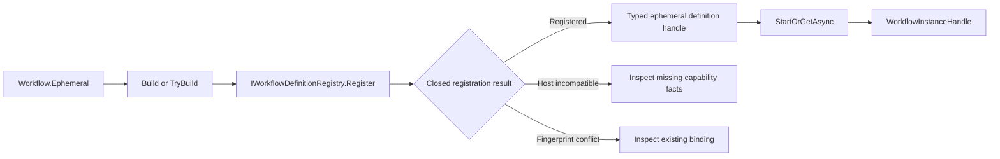
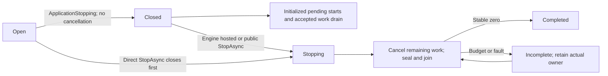
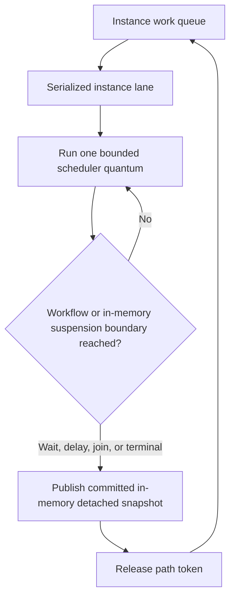
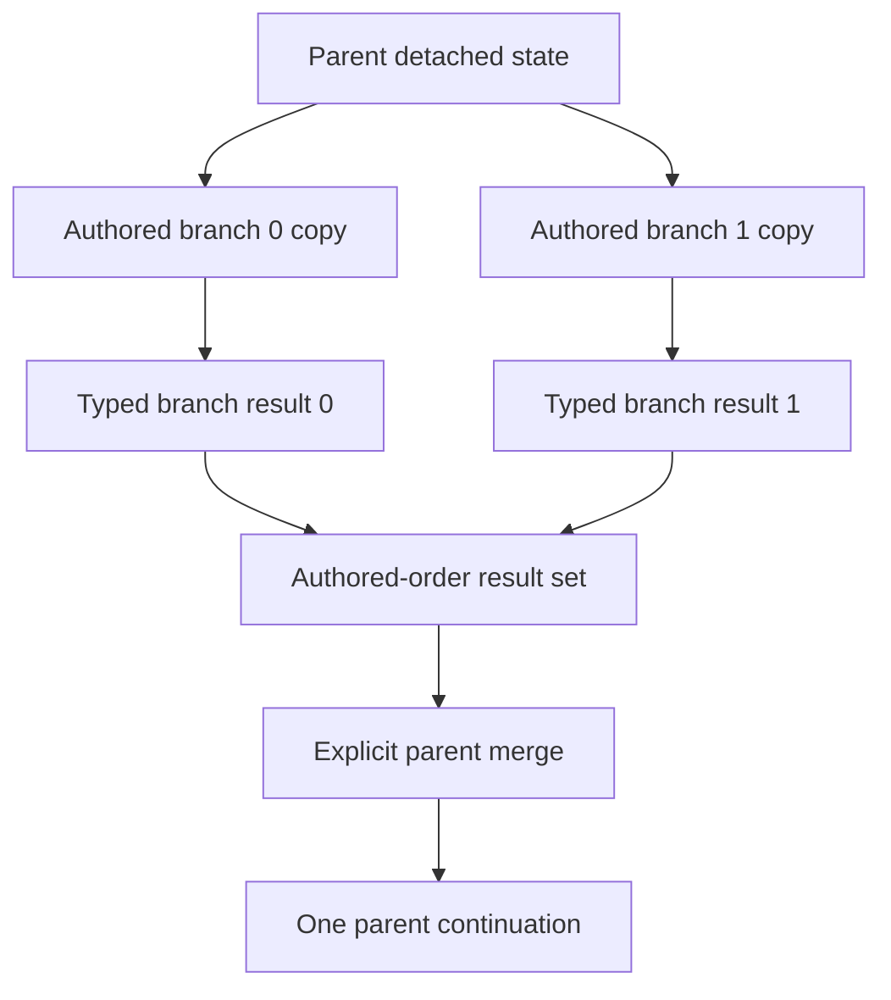
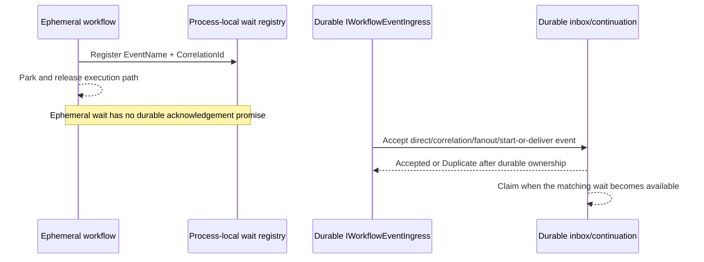
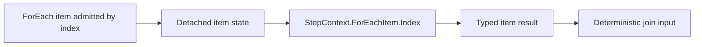

# OrcaCore Ephemeral Engine Runtime Diagrams

These diagrams show the selected v1 flow at application-contract level. Internal scheduling and
compiler types are intentionally omitted. See the
[ephemeral engine developer guide](ephemeral-engine-developer-guide.md) and the
[selected-mode capability matrix](specs/17-selected-mode-capability-matrix.md) for exact semantics.

## Author, register, and start

Shutdown contract addition (implementation pending): the existing role owns one
lifetime singleton; no extra registration or option is introduced. Local wait-token
cancellation remains separate from host cancellation. An initialization admitted
before close can finish and become Accepted while Closed; queued pre-Init rejects.

Closed permits events, waits, timers and retries. Acceptance/abort elects at Stopping,
not at the Closed edge. Completed permits no new live engine work; detached values
and cached stop results are separate from runtime queries. Required source tests
and candidate-package drain consumers remain pending.

## One serialized instance lane

Terminal retention (MG-054–058; implemented and qualified with fresh local consumer packages) does not treat a
published terminal snapshot as proof that every physical step has settled. Accepted active,
waiting, delayed and terminal-but-unsettled instances remain protected. An aborted provisional
start is never published; internal fencing precedes settlement cleanup even with retention off.
An accepted start also does not pin a later output wait: retirement can win before admission.

The ephemeral engine keeps one mutation lane per instance. Structured branch and item work may be
interleaved cooperatively, but user step bodies for one instance do not execute concurrently.

## Fixed fan-out and merge

Branches cannot mutate the parent or one another. Failure, cancellation, or deadline termination
suppresses the merge.

## Wait and durable ingress boundary

## Item context

Outside an admitted item body, `StepContext.ForEachItem` is `null`.

The superseded pre-v1 diagrams are preserved, unchanged, at
[`archive/plans/ephemeral-engine-diagrams.md`](archive/plans/ephemeral-engine-diagrams.md).
